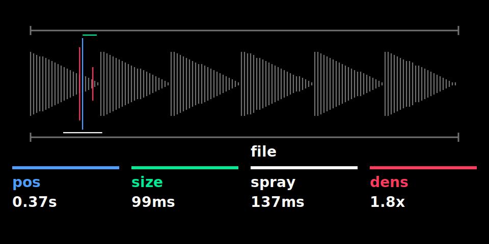
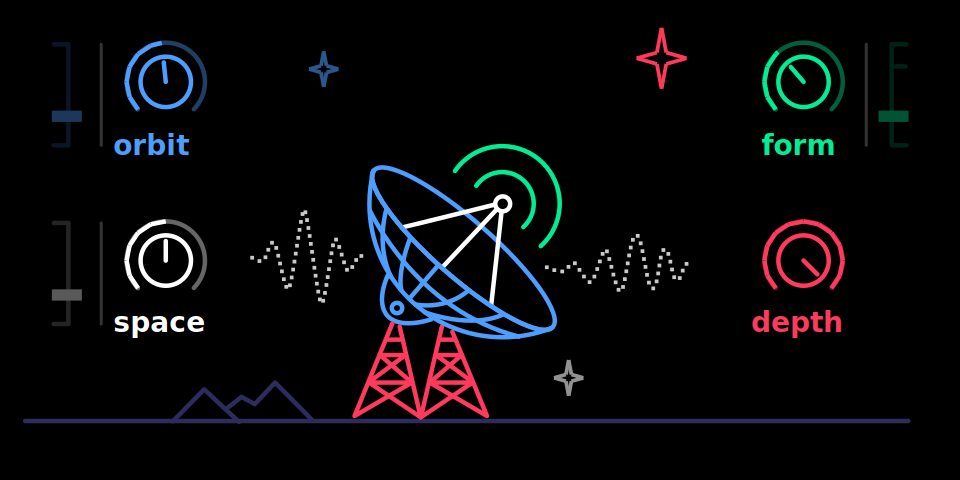
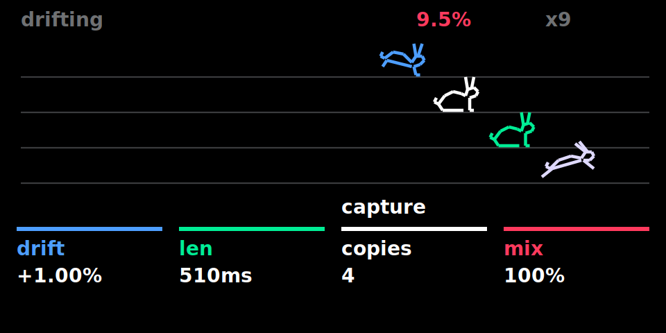
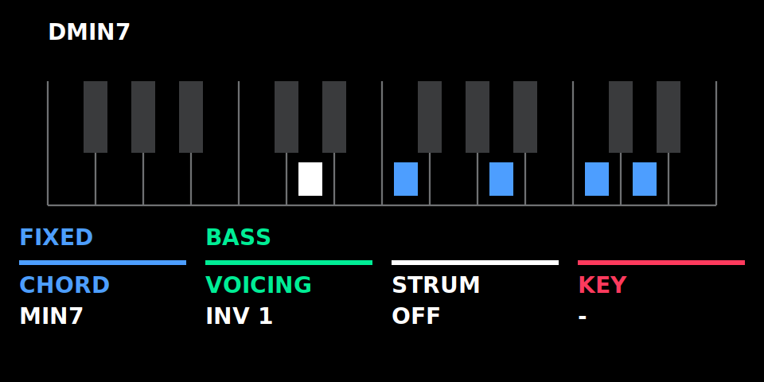
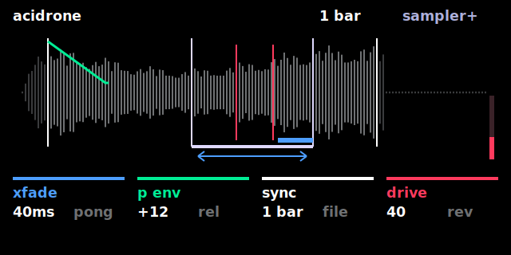
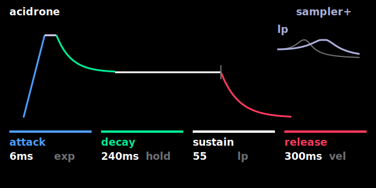
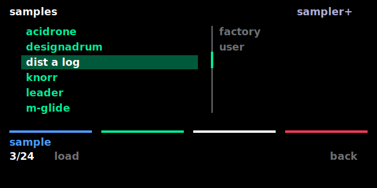

# OP-1 custom firmware patcher (R246)

## Web patcher

### [Patch OG OP1 Firmware in your browser](https://pcppcp.github.io/op1r/web/)

## What is this

Turns the original Teenage Engineering OP-1 firmware **R246** (`op1_246.op1`) into a custom firmware
with:

- custom synth engines with their own screens: **supersaw** (chainsaw), **fmbell** (bell), **granular**; they follow note velocity
  - **granular** plays the slot's sample: press **input** on a granular slot for "keyboard to sample" and record
    straight into it (the slot stays granular); **white press** = sample browser (the sampler presets, as on
    sampler+; the slot stays granular); **red press** = page 2, sample gain (0–4×); values shown in ms / s / ×
- animated **lab screen for the stock iter synth**: gauges follow the knobs; bubbles, flame, falling dashes, voice
  dots and a note display react to the knobs and to what you play (graphic: `iter-lab.svg` from
  [op1repacker](https://github.com/op1hacks/op1repacker), MIT License, © 2016 op1hacks)
- boot screen shows `op1r <version>` under the TE logo
- custom FX with their own screens, usable on instruments **and as master FX** (mixer):
  - **tape**: vintage tape echo (time with tape-speed pitch bends, feedback up to self-oscillation, wow &
    flutter, age)
  - **clouds**: granular texture FX, a port of Mutable Instruments Clouds (position, size, pitch, density;
    encoder presses switch to a second page, red press freezes)
  - **reverb**: lush plate/hall reverb, a port of the Mutable Instruments Elements reverb (time, tone, diffusion,
    mix); its own screen (Kali: graphics by DAN76): blue shows 1–6 arms, green fades in the fire (tone), white brightens the skulls,
    red lights the mix scale
- **quad** LFO: four LFOs in one slot, one row each: live output, frequency, amount, target and type
  - blue frequency (0.05–20 Hz) or tempo division, green amount (±100 %), white target (synth / drum engine knob,
    envelope A D S R, FX knob, or another LFO's frequency / amount / phase offset (F / A / O), shown as a
    symbol plus a dot in the knob / LFO colour; an LFO can't target itself), red type
  - types: **VOIC** (per voice), **FREE** (free-running), **GATE** (restarts at note-on), **MONO** (restarts at every
    note-on, shared), **SHOT** (one cycle after note-on, then holds), **RAND** (new random value per note)
  - press an encoder to select LFO 1–4
  - hold **Shift** for a table of all four LFOs: blue phase offset, green smoothing, white waveform (sine, triangle,
    ramp up/down, square, sample & hold), red sync to the OP-1 tempo (4/1 … 1/32, triplets)
- **euclid** sequencer, an extra sequencer next to the stock ones (pick it in the sequencer list), for synth and drums
  - 6 sequencer slots, each playing one note; **Shift + white** selects the slot, a note key on the euclid screen
    assigns its note, at the octave of that moment
  - blue steps, green pulses, white rotation, red start/stop (**Shift + red**: all slots); press an encoder for
    page 2: rate (1/4 … 1/32, triplets), gate, octave, **level** (note velocity, per slot)
  - the level is always shown as a red bar at the right border (triangle next to the dot while red is on page 2);
    a playing slot shows a red dot in the centre of its ring
  - **Shift + G A B C D E** (the last six white keys) mutes/unmutes slots 1–6, **Shift + D#** mutes/unmutes all;
    a muted slot keeps running (dimmed dots) but plays nothing; works from any screen
  - **Shift + C#** starts all slots at once, or stops them if any is running; works from any screen. Hold **REC**
    (tape armed) while starting and the tape starts recording with the first step
  - **4 patterns** per synth/drum: **Shift + F G A B** (the first four white keys) switches to pattern 1–4
    immediately, from any screen (also the tape view). A pattern holds the notes and settings of all slots incl. mutes;
    which slots are playing stays the same across patterns. The pattern number (P1–P4) is shown bottom left
  - on the euclid screen **lift / drop / scissors** copy / paste / cut the selected slot; with **Shift** the whole
    pattern
  - runs at the OP-1 tempo, plays polyphonically and sends MIDI; slot settings and mutes are saved (slots come
    back stopped)
- **punch in / out at markers**: hold **tape** and press **REC** to arm punch mode (markers turn red, `[o]` around
  the record circle). While playing, forward or in reverse, the next marker starts recording, the one after stops
  it, then punch mode turns off. PLAY while punched in: 1st press ends punch mode (recording continues), 2nd press
  stops recording. STOP stops; armed and stopped, STOP disarms. Tape + REC again cancels
- **sample editor** (synth sampler): on the sampler page hold **synth** and press **scissors**. Blue / green move
  start / end (the sampler's own markers, so keys play the range at once); a blue press switches blue / green to the
  loop points (shown in grey, in blue / green while edited), white zooms (Shift: move the selection),
  red sets the volume of the whole sample (−60 to +24 dB, applied on close; louder clips peaks above full scale), Shift + red scrolls (with transient snap
  on: sets the detection sensitivity, shown as `tr 1`…`tr 7`), red press snaps to zero crossings / transients /
  off. T1 trim (Shift: DC offset), T2 zero (Shift: fade mode: in / out / both, linear / power / exp, length on blue),
  T3 normalize, T4 reverse; Shift + left undoes a trim. Lift / scissors / drop copy, cut and paste the selection
  (paste also onto the tape or another sampler slot). Shift shows the alternate key labels. Closing saves
- **drum sample editor**: on the drum page hold **drum** and press **scissors**: the same editor for the pad played
  last (exact to the sample; pressing a key selects and shows its pad). T1 `fit` trims the pad's silence, Shift + T3
  `auto` cuts the kit into pads (first 24 hits, or 1–24 equal slices; preview, blue sets the sensitivity (`hits 1`…`hits 7`) or the number of slices (equal),
  Shift + left undoes).
  Cut zeroes, drop overwrites. A red line shows the play position (also in the synth editor). Tapping **synth** or
  **drum** alone closes the editor and goes to that mode (synth: its T1 page)
- **count-in**: with the tape stopped, hold **REC** and press **metronome**: 4 / 8 / 16 metronome clicks, then
  recording starts on the next beat and runs until STOP (REC can be released). STOP or REC + metronome again cancels.
  Audible even with the metronome level at 0. The number of beats is set on the settings page: clock / card + **T3**
- **metronome accent**: beat 1 of each 4/4 bar clicks an octave higher (bars follow the tape; after a count-in
  they start where the recording started)
- **Oblique Strategies cards**: **Shift + help** shows a random card from Brian Eno and Peter Schmidt's *Oblique
  Strategies* in the clock's place; Shift + help again shows the clock, again a new card (the last view is
  remembered). T1 / T2 (monitor, USB out) work from both. Idea and card list from
  [ultralazr/op1-oblique-strategies](https://github.com/ultralazr/op1-oblique-strategies) (code MIT, Martin
  Mairinger; the card texts are Eno / Schmidt's and not covered by that licence)
- **resource monitor**: on the clock screen (**Shift + help**) press **T1** to switch to a page with CPU load,
  audio processing load (both with a peak marker), RAM and disk usage and the MIDI in / out buffer fill; T1 again
  goes back to the clock. The audio bar is split into instruments (green), envelopes (blue), custom FX (white) and
  the rest (grey); the blue knob steps through detail pages (audio split, synth / sampler / drum voices, plugins,
  disk)
- **USB track outs**: the OP-1 shows up as a 6-channel USB audio input (24 bit, 44.1 kHz): main L/R on channels
  1–2, tape tracks 1–4 on channels 3–6 (pre-fader, following tape speed and reverse). Clock screen + **T2**: the blue
  knob switches between **MASTER** (track channels silent, saves 5–7 % CPU; default) and **MASTER + TRACKS**; the
  setting is saved. Tested on Linux and macOS (Windows untested: if the OP-1 still shows 2 channels, remove the old
  OP-1 device entry once)
- **tape markers**: on the tape screen, press **red** to set a marker at the cursor, **Shift + red** press removes the
  marker under the cursor, **Shift + red** turn jumps to the next / previous marker (wraps around; works while
  playing). Up to 32 markers, shown as green ticks above the tracks, saved
- **MIDI CC control** (USB MIDI, on the OP-1's MIDI channel):
  - keys: CC = key code + 5 as in the OP-1's own CTRL mode, value ≥ 64 press / < 64 release: 5 help, 6 metronome,
    7–10 synth/drum/tape/mixer, 11–14 T1–T4, 15–17 lift/drop/scissors, 21–25 and 50–52 the keys 1–8,
    26 sequencer, 38/39/40 REC/PLAY/STOP, 41/42 left/right, 43 Shift, 48 mic/input, 49 COM
  - encoders: CC 102–105 = blue/green/white/red, relative (1–63 up, 65–127 down); works on every screen
  - mixer: CC 106–109 track 1–4 volume, 110–113 pan (64 = centre), 114–117 mute (≥ 64 = muted); CC 118 tape input
    level
  - **synth automation** (current synth slot, absolute 0–127, changes the sound like turning the knob): CC 53–56
    engine knobs, 57–60 envelope A/D/S/R, 72–75 FX knobs (when the FX is on), 76–79 LFO knobs (when the LFO is on)
- **MIDI sequencer** (opt-in: clock screen + **T2**, green knob **MIDI SEQ ON**): **SEQ + TAPE** opens a 4-track MIDI
  recorder that runs with the tape (same position, play / stop, loop, markers). **T1–T4** select the track
  (Shift: mute), hold **REC** to record the selected track (Shift + REC latched); from stop, REC held or Shift + REC
  waits for the first note, which starts the tape (recording then stays on until STOP), and **REC held + metronome**
  counts in (4 / 8 / 16 beats, settings page) before it starts. **Shift + blue** turn sets the quantize grid (off,
  1/4 … 1/32, 1/8T, 1/16T): a take's notes snap when it ends; **Shift + blue press** quantizes the selection. **White press** switches between
  the track's input and output, **white turn** chooses I (keyboard), S (stock sequencers / arpeggio), M1–M16 (USB
  MIDI channel) as input and I (instrument), S (stock sequencer), M1–M16 (USB MIDI out) as output. **Scissors** sets
  the selection start / end, **lift** cuts it from the track (Shift + lift: all tracks) and moves the playhead to the
  first note, **drop** pastes at the playhead. Notes and CCs, saved in one song file; TAPE leaves the view
- **dots** step sequencer (pick it in the sequencer list), for synth and drums
  - 6 slots playing at the same time, each up to 64 steps (4 rows of 16 dots); a step is empty (grey) or a
    trigger (green) with its own note and level
  - **blue** moves the cursor, **Shift + white** selects the slot, **red** starts / stops the slot,
    **Shift + red** (or **Shift + C#**) starts / stops all slots
  - **REC** switches recording on / off, **press red** chooses the type: **REC** (step: a note key puts a trigger at
    the cursor and moves on) or **LIVE** (while the slot runs, keys are recorded at the playhead, quantised, with the
    gate taken from how long the key is held; while stopped LIVE records at the cursor). Keys always sound
  - while recording: red sets the level of the trigger, **Shift + blue** erases while moving, **green** changes the
    length, **Shift + green** extends to the next full row and copies the row above
  - per-trigger parameters (white; press white to choose the parameter): gate (or tie), ratchet 1–8, chance,
    condition (play in loop a of b), nudge (±1/2 step), ratchet level ramp
  - **FX parameter locks**: FX1–FX4 in the same list set knob 1–4 (blue … red) of the instrument's FX for that
    step (`--` = off, the default, or 0–100 %); the knob returns to its own setting after the step's gate (TIE: at the
    slot's next trigger). **Press blue** while recording to put a **lock trigger** (no note, hollow square) on an
    empty step, again to remove it; a key on it adds a note
  - mutes (**Shift + G A B C D E**, D# all), 4 patterns (**Shift + F G A B**), lift / drop / scissors copy / paste /
    cut the slot (Shift: whole pattern), all saved
- more synth engines: **mixtur** (subharmonic organ after Oskar Sala's Mixtur-Trautonium), **arc** (Duddell's
  singing arc); more FX: **palme** (Ondes Martenot Palme / Métallique diffuseur), **in a room** (Alvin Lucier's
  *I am sitting in a room* as a looping FX), **steve** (Steve Reich's phase process: capture a loop, 2–4 copies drift
  apart as in *It's Gonna Rain* / *Come Out* or move one unit at a time and lock as in *Piano Phase*; one rabbit per
  copy on the screen; stereo on the master, A left, B right)
- **aether**: a tilt theremin. The key sets the note; tilting the OP-1 forward / back bends the pitch, raising the
  right side fades the volume out, shaking adds vibrato (the angle at the key press is "home"). Blue pitch range,
  green timbre, white vibrato, red volume tilt; presses: dead zone, tilt for the full range, vibrato rate. Its
  screen (graphics by DAN76/Rackes) is a satellite dish that turns with the tilt (dials and sliders show the knobs and page-2 values)
- **oracle** (geomantic shield chart as a 16-step chord / drum pattern) and **peal** (English change ringing)
  sequencers, for synth and drums
- **chord** mode (`chord` sequencer plugin): one key plays a chord, on every screen while the sequencer is on.
  Blue chord type (fixed) or stacked from a key and scale (press), green voicing (close, inversions, drop 2, spread;
  press adds the bass note), white strum (off … 1/8 beat; press: up / down / random), red key and scale. In drum
  mode the chord's notes play as pads
- **MIDI sync** (tempo sync = MIDI in): on MIDI START the stock pattern sequencer, dots and euclid restart so their
  first step falls on the master's downbeat, also right after a pause; notes then follow the external clock within
  about 1 ms
- hidden **OP-Z controller mode** in COM → CTRL, switched on by the SysEx `F0 00 20 76 00 01 03 F7`
  from the host (any MIDI tool that can send SysEx; `F0 00 20 76 00 01 00 F7` switches it off)
- **firmware update over USB MIDI SysEx**: `tools/op1push.py` (op1r-src) or the web patcher stage changed files
  while the OP-1 runs; the OP-1 then asks (T1 restart and apply, T2 cancel). te-boot is never written
- **synths, effects, sequencers, drum+, sampler+ and tools as plugin files**: loaded at boot from `plugins/`, installed / removed one
  by one (web patcher or `op1push.py`) without a firmware update; a plugin that locks the OP-1 at boot is skipped on
  the next boot. Euclid, dots, oracle and peal are sequencer plugins: without the file a sound that uses one loads with
  the pattern sequencer. drum+ (`drumplus`) is a drum plugin: without it drum+ kits play as normal kits. In both cases
  the saved data comes back when the plugin is installed again
- **sampler+** (`samplerplus` plugin, by pcppcp): a synth type next to the stock sampler (Shift + T1, `sampler+`),
  the stock sampler's sound and presets plus loop crossfade, ping-pong, loop in release, pitch envelope, drive,
  random start, velocity → start, reverse, tempo sync (the region or loop lasts 1/4 … 8 bars, repitched) and a
  sample browser (T1 white press, the sampler presets). T2 is an envelope page as on drum+: attack / decay /
  sustain / release with curve and hold, filter (type, cutoff, resonance, envelope and velocity amount). The region
  is still edited in the sample editor (synth + scissors). Without the plugin a sampler+ sound plays as the stock
  sampler and keeps its settings
- **randomiser** (`randomiser` tool plugin, by Lewis-Clayton): on a synth page **Shift + drop** makes a random
  variation of the current sound (engine knobs, envelope, FX type and settings, LFO type and settings; the engine
  stays), **Shift + lift** steps back, Shift + drop again steps forward; the original and the 6 newest variations
  are kept per synth slot. A panel shows `random` (forward) or `modnar` (back)
- the hidden **Lander** game is gone (synth + drum + tape + mixer does nothing): frees about 190 KB of memory and
  shortens the start-up

## Screens

Rendered on the PC from the same screen code that runs on the OP-1 (host harness in the synth SDK).

| Synth engines | |
|---|---|
|  **supersaw** |  **fmbell** |
|  **granular** |  **iter** (lab screen) |
|  **aether**: the dish turns with the tilt, waves = FORM | |

| Effects | |
|---|---|
|  **tape** echo |  **clouds** |
|  **reverb** |  **steve**: four copies drifting apart, one rabbit each |

| LFO | Sequencer |
|---|---|
|  **quad** LFO |  **euclid** sequencer |
|  **dots** sequencer (record mode: notes, lock triggers as hollow squares, a note with an FX lock) |  **chord** mode: the chord's notes on the keyboard, the key played in white (OP-1 font on the device) |

| sampler+ | |
|---|---|
|  **sampler+** T1: region, loop with crossfade / ping-pong, playing voices, pitch envelope, drive |  T2: envelope and filter |
|  T1 white press: sample browser |  **randomiser** panel (Shift + drop; Shift + lift shows `modnar`) |

| Resource monitor | Sample editor |
|---|---|
|  clock screen + **T1** (text in the OP-1 font on the device) |  synth + **scissors** on the sampler page: selection, transient snap (`tr`), key labels (OP-1 font on the device) |

The repository contains no Teenage Engineering firmware. You provide the original update file, and the
patcher applies only the differences stored in `data/`. These are our code, our screen SVGs and small
byte edits.

## Usage

Requirements: Python 3.8 or newer, standard library only.

```sh
git clone https://github.com/pcppcp/op1r.git && cd op1r
python3 patch_op1.py /path/to/op1_246.op1            # -> /path/to/op1_246-custom.op1
python3 patch_op1.py /path/to/op1_246.op1 -o op1-custom.op1
python3 patch_op1.py --info                          # what the patch contains + checksums
python3 patch_op1.py /path/to/op1_246.op1 --plugins supersaw,clouds   # only these synths / FX (default: all)
python3 patch_op1.py /path/to/op1_246.op1 --plugins none              # firmware only
```

**Choosing synths and FX:** the custom synth engines and effects are plugin files (`plugins/<name>.op1p` on the
OP-1), loaded by the firmware at boot. `--plugins` (or the ticks in the web patcher) picks which ones are installed;
`--info` lists the names. Sounds that use a missing one play the stock iter / filter until it is back, then they find
it again by name. With a selection the checksum differs from the one below: the firmware is still verified against
the reference build, each plugin file against its own checksum.

**Managing them later:** an OP-1 that runs op1r 34 or newer needs no firmware file for this. The web patcher
(**Connect OP-1**, section 3) shows the installed synths / effects, installs ticked ones and removes unticked ones over
USB MIDI; the OP-1 asks before anything changes (T1 restart and apply, T2 cancel). From the command line:
`op1push.py --port … --list` / `--delete plugins/<name>.op1p` / `--files plugins/<name>.op1p` (op1r-src).
Only install plugin files from people you trust: a plugin is program code with full access to the OP-1.

The patcher:
1. Checks the input SHA-256 against the original R246 image and refuses anything else.
2. Unpacks it (CRC-32 → LZMA → tar).
3. Checks every file it touches, both before and after patching (SHA-256 per file).
4. Repacks deterministically: original tar order and metadata, op1repacker's LZMA settings.
5. Checks the result against the reference build's SHA-256.

If only the last step differs while the archive content matched, your Python has a different liblzma
version. The firmware content is still verified identical, and `--accept-recompressed` writes it anyway.

| | SHA-256 |
|---|---|
| input `op1_246.op1` (original R246) | `c5315218f825f143b415ca554516541898abee843d3a236df0b54c04e1fb13a9` |
| output (reference build, all plugins) | `253b55c4f6b83e1ccd7abdac2c9d37360c700c145306e0af06db3d1c57553cdc` (also `python3 patch_op1.py --info`) |

Install the result like any OP-1 update (bootloader update mode). The bootloader is not modified, so the
original `op1_246.op1` can always be flashed back. **Use at your own risk.**

Original firmware files (`*.op1`, `*.ldr`, unpacked trees) are git-ignored and must never be committed.

See [CHANGELOG.md](CHANGELOG.md) for what changed between versions.

## Credits

- **pcppcp**: op1r, the synth SDK and most plugins
- **ultralazr**: the plugins arc, mixtur, palme, in a room, oracle and peal, the stroke font of their screens, the
  MIDI sequencer idea; the Oblique Strategies cards ([ultralazr/op1-oblique-strategies](https://github.com/ultralazr/op1-oblique-strategies), Martin Mairinger)
- **Lewis-Clayton**: the randomiser tool plugin
- **DAN76**: the reverb's Kali screen; **DAN76/Rackes**: the aether satellite-dish screen
- **Emilie Gillet** (Mutable Instruments): Clouds and the Elements reverb, ported to fixed point (MIT License)
- **op1hacks**: [op1repacker](https://github.com/op1hacks/op1repacker) (iter lab graphics, LZMA settings; MIT License)
- **Brian Eno and Peter Schmidt**: the Oblique Strategies card texts

## Support

[Buy some tokens for the Clanker](https://ko-fi.com/pcppcp)

## Maintainers: rebuilding the patch data

The patch data is generated from a custom firmware tree built with the synth SDK (`make_firmware.py`,
not part of this repository; needs the Blackfin toolchain):

```sh
python3 <sdk>/synth_sdk/make_firmware.py --opz --release          # builds <sdk>/op1_246_custom/
python3 build_patch.py /path/to/op1_246.op1 <sdk>/op1_246_custom  # regenerates data/ + reference image
```

`build_patch.py` diffs the custom tree against the original image:
- **Changed files** (`OP1_vdk.ldr`, `content/op1_factory.db`): stored as byte edits plus one insertion,
  the new code block.
- **New files** (our SVGs): stored whole.
- **New files identical to a stock file**, such as `fxgeneric.svg` (= `iter.svg`): recorded as `copy_of` and
  recreated from the user's image.

It then runs the patcher once. It writes the reference image (`<custom tree>-patched.op1`, or
`--reference <file>`) and its checksums to `data/manifest.json`, and checks that the reference unpacks to exactly the custom tree.
Flash-test the reference image before publishing a new patch, and commit `data/` together with the
updated output checksum in this README.

## License

op1r is free software under the **GNU General Public License v3.0 or later** ([LICENSE](LICENSE)), with an
additional permission to combine it with the OP-1 firmware ([NOTICE](NOTICE)). In short: use it, modify it and
patch your own firmware freely; if you **distribute** op1r or anything built on it (a modified patcher, another
firmware mod, a product containing this code), you must release its complete source under the same license.

**Source code:** [op1r-src](https://github.com/pcppcp/op1r-src): the firmware code, the synth SDK, and how to write
your own synth / effect plugin ([PLUGINS.md](https://github.com/pcppcp/op1r-src/blob/main/synth_sdk/PLUGINS.md)).
Releases from op1r 27 on are built from it.

Not covered: the Teenage Engineering firmware (never included here) and the Oblique Strategies card texts (Brian Eno
and Peter Schmidt). Third-party parts (MIT): Mutable Instruments Clouds / Elements reverb ports (Emilie Gillet),
op1repacker's iter-lab.svg and LZMA settings (op1hacks), svgfont.py (Martin Mairinger). Details in [NOTICE](NOTICE).
